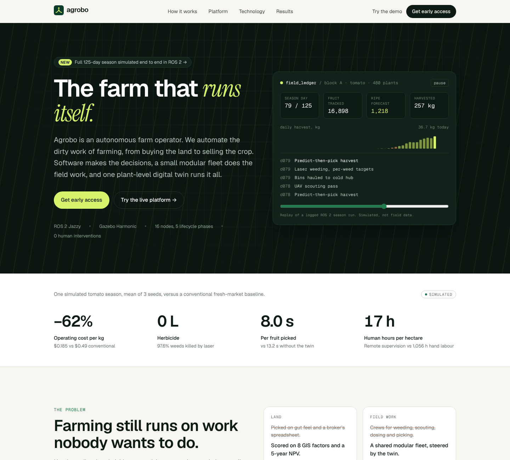

# Agrobo

**The autonomous farm operator.** Agrobo automates farming end to end, from choosing the land to selling the crop. Software makes the decisions, a small modular robot fleet does the physical work, and one plant-level digital twin (the *Field Ledger*) runs it all.



This repository holds everything built for the November milestone:

| Folder | What it is |
|---|---|
| [`web/`](web/) | The company website and live platform demo. Next.js 16 + TypeScript, deployable to Vercel. Its APIs run the simulation's models ported to TypeScript. |
| [`simulation/`](simulation/) | The ROS 2 Jazzy + Gazebo Harmonic simulation of a full 125-day tomato season across all five lifecycle phases, with the twin-vs-no-twin ablation and KPI report. |
| [`robots/`](robots/) | Hardware rev A: harvester UGV and common base. CAD (STEP/DXF/STL), BOM, schematics, URDF, build plan. `cad/src/params.py` is the source of truth. |
| [`training/`](training/) | Perception and picking-RL training pipelines (CPU smoke tests in cloud, real runs on a local GPU). |
| [`world/`](world/) | ROS 2 + Gazebo robot training world with auto-labelled tomatoes and weeds, randomized fields and a Blender image generator. |
| [`land/`](land/) | SW Florida farmland shortlist. The parcel analyzer lives in `simulation/tools/land_analyzer.py`. |
| [`film/`](film/) | Source for the product film (scene scripts, overlays, score). Rendered frames and MP4s are not in git. |

> The season sim assumes a 95% pick success rate; the learnt picker in `training/` is at 29% today. `simulation/tools/pick_sensitivity.py` re-scales OpEx for lower pick rates: break-even with hand crews is about 32%, and $0.30/kg needs about 55% ([results](simulation/results/REPORT.md#pick-success-sensitivity)).

> All performance numbers (cost per kg, picker speed, fleet size, revenue uplift) come from the simulation. Perception, manipulation, prices and costs are calibrated models, not field data. The website labels them as simulated.

## How the website uses the simulation

```
simulation/ros2_ws/src/agrobo_sim/agrobo_sim/core/*.py      web/src/lib/engine/*.ts
  strategy.py   (GIS suitability, crop matrix, NPV)   ──port──▶  strategy.ts  → POST /api/land/evaluate, /api/land/score
  economics.py  (Agrobo vs conventional OpEx)         ──port──▶  economics.ts ┐
  results/runs/*/kpis.json (per-ha activity, 3 seeds) ──export─▶ planner.ts   ┘→ POST /api/economics
  market.py     (B2B selling engine)                  ──port──▶  market.ts    → POST /api/market
  results/runs/*/events.jsonl (day-by-day season log) ──export─▶ season_*.json → GET /api/season, Season replay, hero console
  results/kpi_summary.json                            ──export─▶ kpi_summary.json → GET /api/kpis, Results page
```

`web/tests/parity.test.ts` checks the ports against the Python outputs (suitability factors, OpEx per kg, fleet capex, contract penalties).

After re-running the simulation, refresh the site's data:

```bash
cd web && npm run export-data      # python3 scripts/export_sim_data.py ../simulation/results src/data
```

## Quick start

```bash
# website
cd web
npm install
npm run dev        # http://localhost:3000
npm test           # parity tests vs the Python sim
npm run build

# simulation (see simulation/README.md for the full setup)
cd simulation/ros2_ws && colcon build && source install/setup.bash
ros2 launch agrobo_sim season.launch.py twin_guided:=true run_name:=demo output_dir:=../results/runs
```

## Deploying the website

On Vercel, import this repo and set **Root Directory** to `web`. Optional env vars are in [`web/.env.example`](web/.env.example); set `WAITLIST_WEBHOOK_URL` so early-access signups reach you (without it they are only written to a local file, which does not persist on serverless hosts).
