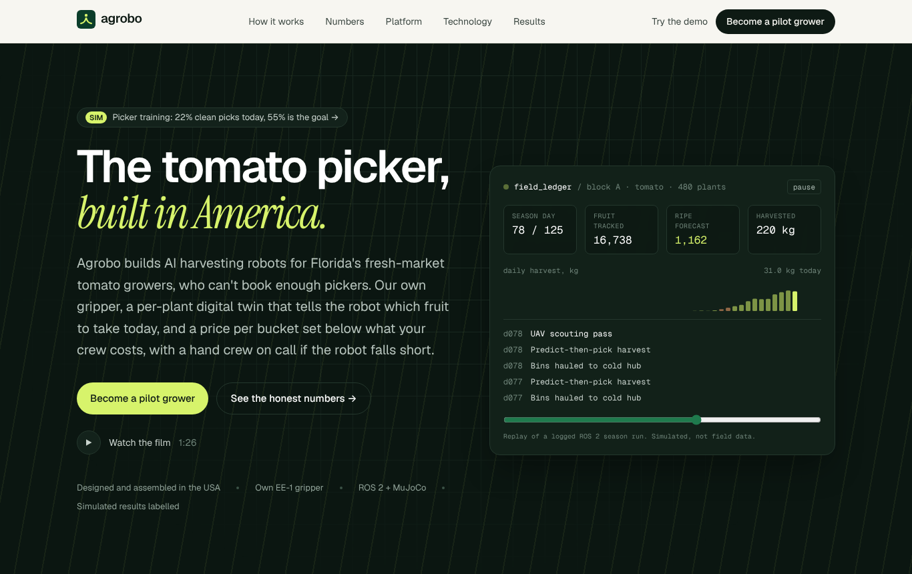

# Agrobo

**The tomato picker, built in America.** Agrobo builds AI harvesting robots for Southwest Florida's fresh-market tomato growers, who can't book enough pickers. Our own EE-1 gripper (three soft Fin-Ray fingers around a 65 mm suction plunger), a per-plant digital twin (the *Field Ledger*) that tells the robot which fruit to take on each pass, and a price per field bucket set below the grower's crew cost, with a hand crew on call if the robot falls short.

Designed and assembled in the USA. We do not say "Made in USA": the FTC reserves that for all or virtually all US content, and about 6% of the rev B parts value (LFP cells, Jetson compute, the wrist depth camera, tyres) has no US source yet.



## Where it stands (2026-11-02)

| | Today | Source |
|---|---|---|
| Learnt picker, simulation | 29% of fruit picked, 22% clean (no bruise, no neighbour knocked off), after 1.3M of 20M training steps | [`training/`](training/) |
| Scripted picker baseline | 42% picked | [`training/`](training/) |
| Twin vs no twin, season sim | 8.0 vs 13.2 s per fruit, 1.23 vs 1.93 robots per ha (assumes 95% pick success) | [`simulation/results/REPORT.md`](simulation/results/REPORT.md) |
| Robot, imported parts (rev A.1) | $51.9k built, $36.4k per robot at 100 units | [`robots/`](robots/) |
| Robot, US-sourced (rev B) | $129.9k built; 93.6% of parts value made or assembled in the US | `robots/docs/05_REVB_MADE_IN_USA.md` (PR #2) |
| Robot hardware | Designed to build level, not built yet | [`robots/docs/03_BUILD_AND_TEST.md`](robots/docs/03_BUILD_AND_TEST.md) |

### Break-even: when does the robot beat a crew?

`simulation/tools/pick_sensitivity.py harvester` compares the harvester's cost per kg with a hand crew's (assumed $22/h at 85 kg/h, so $0.259/kg, until grower calls replace it). Robot cost per hour is capital recovered at 10% over 5 years, 10% maintenance and $12k a year of fixed costs. Pick success needed to match the crew:

| Robot | One season (1,500 h) | Two seasons (3,000 h) | Priced 15% below crew |
|---|---:|---:|---:|
| Imported parts, 100 units ($36.4k) | 48% | 24% | 56% |
| Imported parts, first build ($51.9k) | 59% | 29% | 69% |
| US-built rev B, first build ($129.9k) | not reachable | 56% | not reachable |

The US-built robot can't beat a crew in one Florida season even at 100% pick success. It does at about 55% if it works a second harvest further north in summer, or once the robot price falls to about $46.8k. Fast mature-green crews (150 kg/h) push every row much higher, so crew rates are the first thing grower calls measure. Full output: [`simulation/results/harvester_break_even.json`](simulation/results/harvester_break_even.json).

> The season sim assumes a 95% pick success rate. `simulation/tools/pick_sensitivity.py` (no argument) re-scales the whole-farm OpEx for lower pick rates: whole-farm break-even with a conventional farm is about 32%, because it spreads robot cost over weeding and hauling too. The harvester alone needs the numbers above.

> All performance numbers come from simulation. Perception, manipulation, prices and costs are calibrated models, not field data. The website labels them as simulated.

## What's in the repo

| Folder | What it is |
|---|---|
| [`web/`](web/) | The company website and platform demo. Next.js 16 + TypeScript, deployable to Vercel. Its APIs run the simulation's models ported to TypeScript. |
| [`simulation/`](simulation/) | ROS 2 Jazzy + Gazebo Harmonic simulation of a 125-day tomato season with the per-plant twin, the twin-vs-no-twin ablation, and the break-even tools in `tools/`. |
| [`robots/`](robots/) | Harvester hardware: CAD (STEP/DXF/STL), BOM, schematics, URDF, build plan. `cad/src/params.py` is the source of truth. |
| [`training/`](training/) | Perception (YOLO11-seg) and picking-RL (MuJoCo, BC + PPO) pipelines. |
| [`world/`](world/) | ROS 2 + Gazebo robot training world with auto-labelled tomatoes and weeds, randomized fields and a Blender image generator. |
| [`land/`](land/) | Later add-on: SW Florida farmland shortlist; the parcel analyzer is `simulation/tools/land_analyzer.py`. |
| [`film/`](film/) | Source for the product film. Rendered frames and MP4s are not in git. |

The season sim and website still model the longer-term vision (land, field prep, weeding, selling) as add-ons. The product we are building first is the harvester.

## How the website uses the simulation

```
simulation/ros2_ws/src/agrobo_sim/agrobo_sim/core/*.py      web/src/lib/engine/*.ts
  strategy.py   (GIS suitability, crop matrix, NPV)   ──port──▶  strategy.ts  → POST /api/land/evaluate, /api/land/score
  economics.py  (Agrobo vs conventional OpEx)         ──port──▶  economics.ts ┐
  results/runs/*/kpis.json (per-ha activity, 3 seeds) ──export─▶ planner.ts   ┘→ POST /api/economics
  market.py     (B2B selling engine)                  ──port──▶  market.ts    → POST /api/market
  results/runs/*/events.jsonl (day-by-day season log) ──export─▶ season_*.json → GET /api/season, Season replay, hero console
  results/kpi_summary.json                            ──export─▶ kpi_summary.json → GET /api/kpis, Results page
```

`web/tests/parity.test.ts` checks the ports against the Python outputs (suitability factors, OpEx per kg, fleet capex, contract penalties).

After re-running the simulation, refresh the site's data:

```bash
cd web && npm run export-data      # python3 scripts/export_sim_data.py ../simulation/results src/data
```

## Quick start

```bash
# website
cd web
npm install
npm run dev        # http://localhost:3000
npm test           # parity tests vs the Python sim
npm run build

# break-even tool and its tests
python3 simulation/tools/pick_sensitivity.py harvester simulation/results
python3 -m unittest discover -s simulation/tools -p 'test_*.py'

# simulation (see simulation/README.md for the full setup)
cd simulation/ros2_ws && colcon build && source install/setup.bash
ros2 launch agrobo_sim season.launch.py twin_guided:=true run_name:=demo output_dir:=../results/runs
```

## Deploying the website

On Vercel, import this repo and set **Root Directory** to `web`. Optional env vars are in [`web/.env.example`](web/.env.example); set `WAITLIST_WEBHOOK_URL` so early-access signups reach you (without it they are only written to a local file, which does not persist on serverless hosts).
