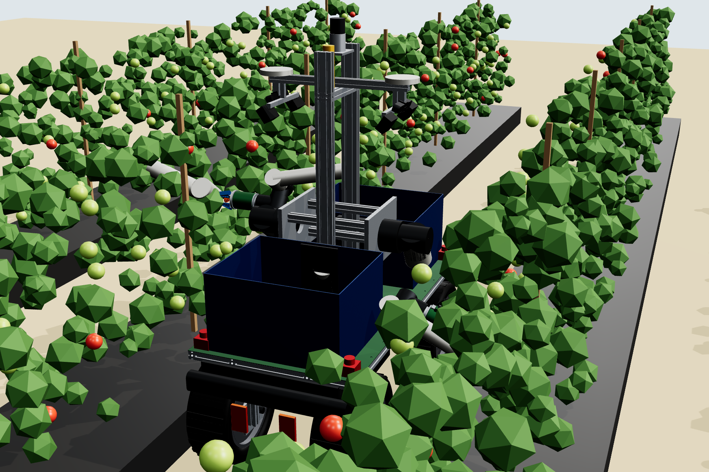

# Agrobo robots: hardware design package (rev B BOM, 2026-11-01; geometry rev A.1)

**Rev B (2026-11-01): US-sourced BOM.** Every part with a US-made or US-assembled option is swapped, e.g. the Standard Bots Spark arms (NY), Ouster lidar, MultiSense S27 stereo, and inboard motors with Winsmith reducers. The cost is **$125.4k per robot at pilot quantity, or $129.9k with assembly**, against $51.9k for rev A.1 (+150 %). The arms account for most of the increase. Rev B qualifies for "Assembled in USA" but not an unqualified FTC "Made in USA" claim: cells, Jetson and the D405 still have no US source, which is 6.4 % of the value. See [docs/05_REVB_MADE_IN_USA.md](docs/05_REVB_MADE_IN_USA.md) and `bom/Agrobo_BOM_revB.xlsx`. The CAD, URDF and calcs below still describe the rev A.1 geometry.

Rev A.1: suction-cup stroke 30 → 65 mm (linear actuator), FR5 datasheet joint ranges in URDF/IK, side-mount approach notes. Found by the training sim.

Build-level design of the **Agrobo harvester** (AB-1 base + HM-1 harvester implement + 2× EE-1 end-effector) for Southwest Florida staked fresh-market tomatoes, plus module-level designs for the hauler, weeders, sprayer, scout UAV and dock.



## Headline numbers

| | |
|---|---|
| Harvester robot BOM | **$48.3k** at pilot quantity, **$36.4k** at 100 units |
| Size / mass | 1.62 × 0.78 m footprint, 1.91 m tall; 434 kg with full totes |
| Energy | 10.75 kWh LFP, 8.8 h picking per charge, **17.8 h/day** with autonomous dock charging |
| Reach | 2 × 6-DoF arms (FAIRINO FR5), 99.8 % of the aisle-side fruit band reachable from one stop |
| Pick rate target | 9 s/fruit per arm → **5.3 s/fruit per robot** (the sim assumed 8.0 s) |
| Stability | 27.5° lateral tip angle (25.9° with one arm out holding fruit) |
| Fleet capex | $82k/ha pilot (+6 % vs the modelled $77k); **$61k/ha at 100 units (−21 %)**; $42k/ha if the pick-rate target is hit |

## What is in here

| Folder | Contents |
|---|---|
| `docs/01_DESIGN.md` | Operating envelope, fleet, base, harvester, end-effector, other modules, what is verified vs not |
| `docs/02_ELECTRICAL_AND_SAFETY.md` | Power, safety chain, data architecture, standards and compliance path |
| `docs/03_BUILD_AND_TEST.md` | Procurement order, 8-day assembly sequence, 11 acceptance tests, timeline to a field pilot |
| `docs/04_COST_VS_MODEL.md` | Real BOM vs the prototype's $77k/ha model |
| `bom/Agrobo_BOM.xlsx` (+ CSVs) | Every line with manufacturer, model/MPN, qty, unit price, price basis (quote URL or estimate), 100-unit factor |
| `cad/step/` | STEP: full harvester, hauler, end-effector assemblies + fabricated parts |
| `cad/dxf/` | Laser-cut plates (deck, axle plates, arm mount plates) |
| `cad/stl/` | 3D-print parts for the end-effector (housing, front plate, Fin-Ray finger, brackets) |
| `cad/cut_list_1515.csv` | 80/20 profile cut list (18.8 m) |
| `cad/renders/` | Renders: hero, in-aisle, front clearance view, end-effector, hauler |
| `cad/src/` | **Parametric source.** `params.py` is the single source of truth; `build.py` (CadQuery) regenerates all CAD + URDF meshes; `kin.py` is FK/IK for the arms |
| `electrical/` | E-01 power single-line, E-02 safety circuit, E-03 data/comms (PDF + SVG), `harness.csv` wire list |
| `calc/` | Design calcs (`results.md`: mass, stability, traction, power, reach, cycle time, ground pressure) and fleet capex |
| `urdf/agrobo_description/` | **ROS 2 package for simulation and training**: URDF, meshes, ros2_control config, Gazebo launch, Florida aisle test world |
| `preview/gazebo-cameras.jpg` | What the robot's mast camera and gripper camera see in Gazebo |

## Simulation / training model

```bash
# ROS 2 Jazzy + Gazebo Harmonic
cp -r urdf/agrobo_description ~/ws/src/ && cd ~/ws && colcon build && source install/setup.bash
ros2 launch agrobo_description gazebo.launch.py world:=$(ros2 pkg prefix agrobo_description)/share/agrobo_description/worlds/aisle_test.sdf
ros2 topic pub -r 20 /base_controller/cmd_vel geometry_msgs/msg/TwistStamped "{twist: {linear: {x: 0.5}}}"
```

For Isaac Lab, import `urdf/agrobo_description/agrobo_harvester.relative.urdf` (relative mesh paths, no Gazebo tags). Tested 2026-10-21 in Gazebo Harmonic + ROS 2 Jazzy: the robot drove 5.5 m straight with no lateral drift, both arms reached IK targets exactly, and all 4 cameras, the lidar, IMU and GNSS published. On a machine without a GPU, add `headless:=true headless_rendering:=false` and run under Xvfb.

## Regenerate everything after a design change

```bash
pip install cadquery trimesh yourdfpy scipy schemdraw openpyxl matplotlib
python cad/src/build.py            # CAD, renders sources, URDF meshes, cut list
python urdf/generate_urdf.py       # URDF from params.py
python urdf/validate_urdf.py       # URDF vs CAD kinematics check
python calc/design_calcs.py        # engineering calcs
python bom/build_bom.py            # BOM CSV/XLSX + cost summary
python calc/fleet_capex.py         # $/ha vs the model
python electrical/build_schematics.py
```

## Before cutting metal (open items)

1. Get vendor STEP/drawings for the FR5 (base bolt pattern, exact link lengths, which sets the DH values in `params.py`), the OZO hub motor (shaft diameter and flats) and the ZED X mount, and update `params.py`.
2. Confirm the bed spacing with the first grower (5 ft vs 6 ft centres changes the aisle width).
3. Get quotes for every "est" BOM line; the FR5 DC-controller and IP65 options in particular.
4. Bench-test EE-1 on real mature-green fruit of a jointless variety before ordering the arms.
