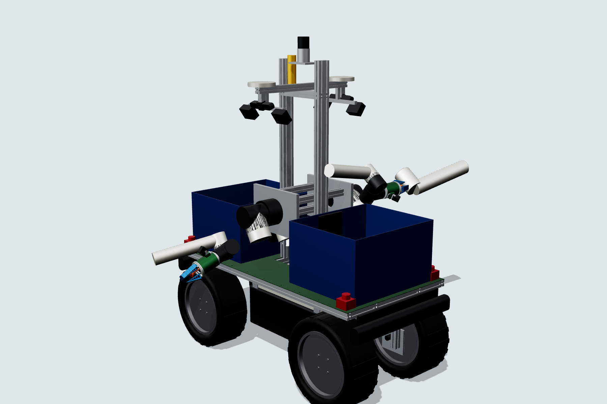
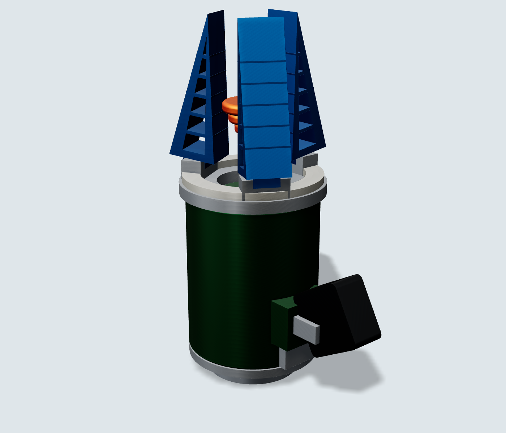

# Agrobo robot fleet: design description (rev A, 2026-10-21)

Scope: the hardware that runs a Southwest Florida fresh-market tomato farm end to end. The harvester (the moat: predict-then-pick) and its common base platform are designed to build level. Hauler, weeder, sprayer, UAV and dock are designed to module and BOM level.

## 1. Operating envelope (design inputs)

| Input | Value | Source / note |
|---|---|---|
| Crop | Staked, string-woven fresh-market tomato on raised, plastic-mulched beds | Standard Florida plasticulture |
| Bed geometry | 1.83 m (6 ft) centres, 0.81 m top, 0.20 m high, one row per bed, plants 0.51 m apart | UF/IFAS typical; **confirm with the first grower** (some use 5 ft centres) |
| Aisle (row middle) | ~0.9 m at the soil, ~1.1 m clear between canopies above bed height | Derived |
| Fruit band | 0.45-1.40 m above ground, mostly on the aisle-facing half of the canopy | Staked plants pruned below first cluster |
| Harvest stage | **Mature-green** (most Florida fruit is picked mature-green and ripened with ethylene), plus breaker/vine-ripe for premium | [UF/IFAS VH079](https://ask.ifas.ufl.edu/publication/VH079/pdf) |
| Soil | Sandy (Immokalee/Myakka type), wet and soft after rain | Traction + flotation driver |
| Climate | 35 °C + full sun, 90 % RH, daily summer storms, salt air near the coast, lightning | Thermal, IP rating, corrosion |
| Duty | 16-18 h/day in harvest peak, night picking under lights | Matches the prototype sim's 18 h/day |

Two domain findings change the prototype's module list:
- **Nitrogen goes through the drip tape under the plastic** (fertigation). Per-plant root-zone injection would mean punching the mulch, so the "micro-doser" becomes zone-level fertigation control (valves on the drip manifolds, driven by the Field Ledger) plus a **spot-sprayer implement (SP-1)** for the real Florida problem: fungal and bacterial disease in humid weather.
- **On plastic mulch, weeds grow in the aisles and in the planting holes only.** Aisles can be cultivated mechanically (LW-1M, $4k) instead of lasered (LW-1, $31k). Lasers are kept for the planting-hole and nutsedge case. This is the single biggest cost lever after the arms.

## 2. Fleet

| Unit | What it is | Status in this package |
|---|---|---|
| **AB-1 base** | 4WD skid-steer aisle runner, 10.75 kWh LFP keel pack, 48 V, Jetson AGX Orin, RTK + lidar, auto-coupler deck | Build-level: CAD, BOM, schematics, calcs |
| **HM-1 harvester implement** | Mast with 2 side-mounted 6-DoF cobots (FAIRINO FR5), 2 ZED X stereo, 2 totes on transfer rollers | Build-level |
| **EE-1 end-effector** | 3 Fin-Ray fingers + central suction bellows + eye-in-hand D405, twist-to-detach | Build-level, printable parts |
| HL-1 hauler | AB-1 base + 8-tote roller rack; swaps totes with harvesters at the headland | CAD + BOM |
| LW-1 / LW-1M weeder | 2x 100 W CO2 galvo heads in a light-tight hood / electric aisle rotary hoe | Module spec + BOM estimate |
| SP-1 spot sprayer | 100 L tank, 12 PWM nozzles, per-plant targeting | Module spec + BOM estimate |
| SU-1 scout UAV | ArduPilot quad, RTK, multispectral + RGB | BOM estimate |
| DK-1 dock | 3.5 kW charger, contacts, shade, implement-swap stands | BOM estimate |
| Land prep | **Contract it in year 1** (bed press + plastic layer is 1-2 passes a season; Florida custom operators exist). Automate later with a retrofit kit on a leased tractor | Recommendation; saves the modelled $90k prep UGV |

## 3. AB-1 base platform

- **Layout: aisle runner, not a bed straddler.** Overall width 0.78 m over the tyres, so it drives in the 0.9 m row middle and works the two rows on either side. A straddler would need ~1.9 m track and 1.6 m clearance over staked plants: heavier, taller, and it cannot turn in Florida headlands.
- **Frame:** bolt-together 80/20 1515 profile deck (1.50 × 0.76 m, top at 0.60 m), four vertical legs to 10 mm 6061 axle plates. Total 18.8 m of profile (`cad/cut_list_1515.csv`). No welding for pilot units; a welded 6061 frame at volume.
- **Drive:** 4 × OZO 3 kW 48 V hub motors (130 N·m nominal, 200 N·m peak) on 20x8.00-10 turf tyres, Flipsky VESC FOC controllers on CAN. Demand: 54 N·m continuous and 162 N·m peak per wheel (loose sand Crr 0.15, wet furrow 0.25, 5 % grade, 0.3 g). Ground pressure 55 kPa.
- **Energy:** 16S2P EVE LF105 LFP keel pack, 51.2 V 210 Ah = 10.75 kWh, hung low between the wheels. 1.09 kW average while picking gives 8.8 h; dock charge at 3.5 kW takes 2.9 h, so **17.8 h/day** of work with autonomous dock charging (no battery swapping in v1).
- **Stability:** gross 434 kg with full totes, CoG 0.56 m. Lateral tip angle 27.5° (25.9° with one arm fully out holding fruit); requirement ≥ 18° (3 × a 6° bed-shoulder tilt). Longitudinal 44.7°.
- **Electronics:** IP66 enclosure slung **under** the deck (shaded) with a 24 V thermoelectric cooler; Jetson AGX Orin 64GB, Teensy 4.1 real-time I/O on 3 CAN buses, Moxa switch, Teltonika 5G router.
- **Navigation sensors:** Livox Mid-360 on the mast top, ArduSimple dual-antenna RTK (FDOT FPRN corrections are free in Florida), MicroStrain CV7 IMU.
- **Implement interface:** 4 locating cones + 2 cam locks on the deck, one floating Harting Han-Modular connector (48 V, 24 V, 2× CAN, GbE, E-stop loop). Implement swap is done at the dock stand (prototype assumed 6 min).

## 4. HM-1 harvester implement

- **Arms:** 2 × FAIRINO FR5 (5 kg, 922 mm, IP54 arm, DC controller fed directly from the 48 V bus), side-mounted on a 1530 mast at 0.95 m, base axes pointing left and right. One arm per row. **99.8 %** of the fruit band on the aisle-facing half of the canopy is reachable from one stop (±0.45 m along the row); fruit on the far side is picked from the next aisle. No vertical lift is needed. Arm covers keep IP54 arms usable in rain.
- **Joint ranges (FR5 datasheet):** J1 ±175°, J2 +85/−265°, J3 ±160°, J4 +85/−265°, J5/J6 ±175°. These are now in the URDF and IK; check the sign convention against the vendor URDF zero before relying on them on hardware. The asymmetric J2 allows the elbow-back posture that keeps the forearm out of the canopy.
- **Side-mount dead zone:** a straight-in approach is singular for fruit directly in front of the arm base and within ~0.1 m of shoulder height (z ≈ 0.95 m). The planner parks the robot so the target plant is 0.15-0.4 m ahead of or behind the shoulder. Fruit low in the band (0.45-0.75 m) is reached approaching from above at ~30° down. Rev B option: tilt the arm base 10-15° down, to be decided from the sim's reach statistics.
- **Why FR5:** $6,999 list vs ~$35k for a UR5e, DC-input controller, ROS 2 driver. A purpose-built 4-5 DoF arm is the v2 cost-down item.
- **Perception:** ZED X stereo per side (global shutter, IP67, GMSL2) for row-level fruit mapping; D405 on each gripper for the last 10 cm. Lights for night picking.
- **Fruit handling:** two 600 × 500 × 350 totes (~35 kg fruit each) on 24 V motor-driven-roller zones. The hauler parks beside the harvester at the headland and the totes roll sideways across. At the design-target rate the totes fill in about 31 minutes.
- **Cycle-time budget (per arm):** approach 2.5 s (twin-predicted target, no search) + visual servo 1.8 + grasp 0.8 + twist-detach 1.2 + place 2.6 + log 0.1 = **9.0 s**. Two arms at 85 % utilisation give 680 fruit/h = **5.3 s/fruit per robot**. The prototype sim modelled 8.0 s/fruit, so the sim is the conservative case. 9 s/arm is a bench target, not a measurement; research pickers run 10-25 s/fruit/arm.

## 5. EE-1 end-effector

- ISO 9409-1-50-4-M6 adapter → sealed MJF PA12 housing (O-ring grooves, IP65 target) holding a DYNAMIXEL XM430 that drives a lead-screw cam ring closing **3 TPU Fin-Ray fingers** (wrap the fruit without point loads). Grip force is set by the servo current limit (target 3.6 ± 0.55 N per the prototype spec).
- A **40 mm bellows suction cup** rests with its lip just past the fingertips and touches first. The vacuum switch confirms the seal (the contact sensor). An Actuonix L16 linear actuator then **retracts the cup 65 mm**, drawing a 70-80 mm fruit back so it sits between the Fin-Ray fingers before they close. (Rev A had a 30 mm plunger; the training sim showed the fingers then close on air.)
- **Detach:** wrist-3 twist (120°) plus a short pull, so the fruit separates at the calyx. This needs **jointless-pedicel varieties** (common in Florida mature-green breeding); stems on fruit puncture other fruit in the tote.
- **Eye-in-hand:** D405 at 80 mm offset, aimed at the grasp centre (0.205 m from the flange). In the Gazebo check the target fruit is visible between the fingers; the ring light covers the top ~25 % of the image. The fix for rev B is a lower-profile ring.
- Printable parts in `cad/stl/` (EE1-002 housing, EE1-003 front plate, EE1-004 finger). Fingers are consumables; swap them weekly.

## 6. Other modules (design level)

- **HL-1 hauler:** AB-1 base unchanged, plus a 2-high rack for 8 totes on 4 roller zones (~280 kg payload; the base drive is sized for 434 kg gross). Model assumption: 1 per 8 ha.
- **LW-1 laser weeder:** 2 × sealed RF CO₂ 100 W + 10.6 µm galvo heads, RGB detection cameras with strobe, light-tight brush-skirted hood with interlocks (Class 4 laser). $30.7k at pilot prices. **LW-1M** electric rotary hoe for aisles is $4k. Recommended v1: LW-1M fleet-wide plus a small number of LW-1 units for planting holes.
- **SP-1 spot sprayer:** 100 L tank, 48 V pump, 12 PWM nozzles fired per plant from the twin's disease map.
- **SU-1 UAV:** Holybro X650 + Pixhawk 6X + H-RTK F9P + multispectral camera (MicaSense RedEdge-P class), ~$11k. Not DJI: US federal restrictions on DJI make it a supply-chain risk. Needs Part 107; routine BVLOS needs a waiver until the FAA's BVLOS rule is in force.
- **DK-1 dock:** 3.5 kW CAN charger, spring contacts, steel shade shelter, implement stands. One per 2 UGVs.

## 7. What is verified vs. what is not

| Verified (this package) | Not verified yet (needs the first prototype) |
|---|---|
| Geometry fits the Florida aisle with 50-60 mm per side | Real arm cycle time and the detach success rate on real plants |
| Arm reach covers 99.8 % of the near-side fruit band (geometric) | Self-collision and canopy-collision planning (MoveIt) in dense foliage |
| URDF FK = CAD kinematics (max error 1.5e-5 m over 400 random poses) | Hub-motor torque ripple at < 0.1 m/s crawl speed |
| Gazebo: drives 5.5 m straight with no drift, both arms track IK targets exactly, all 4 cameras + lidar + IMU + GNSS publish | Thermal: enclosure cooler sizing in July sun |
| Static stability, traction, energy, ground pressure (hand calcs, `calc/`) | IP rating of the printed EE housing; FR5 behaviour in rain under the cover |
| | Vendor drawings: FR5 base bolt pattern, OZO shaft diameter/flats |
