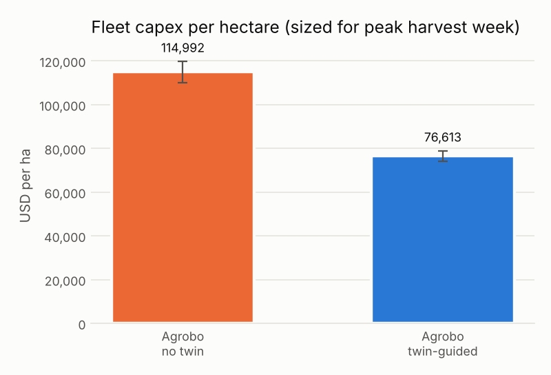
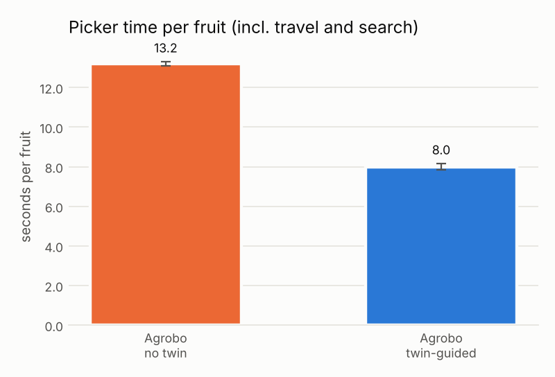
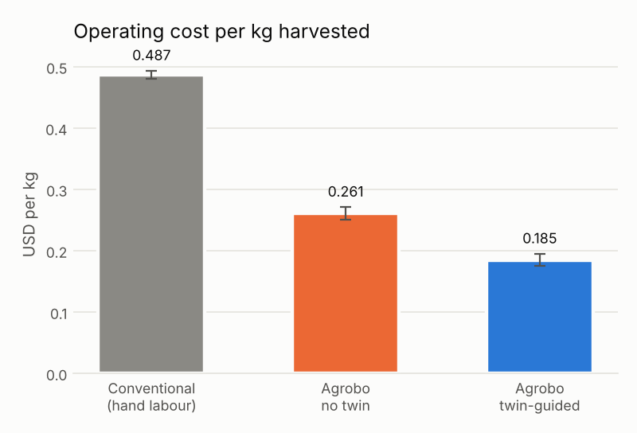

# Agrobo Season Simulation: KPI Report

Field: 0.036 ha block, 480 tomato plants (10 rows x 48, 1.5 m x 0.5 m), 125-day season, ROS 2 Jazzy, 3 seeds per arm. Both arms use the same robots, field and weather; only the Field Ledger twin is switched off in the ablation (`twin_guided:=false`). Values are mean ± sd across seeds.

## Results

| | Metric | Twin-guided | No twin (ablation) | Δ twin vs no twin |
|---|---|---|---|---|
| KPI 1 | Herbicide used (L/ha) | 0.0 ± 0.0 | 0.0 ± 0.0 |  |
| KPI 1 | Weed-control efficacy (%) | 97.6 ± 0.6 | 97.3 ± 1.0 | +0 % |
| KPI 1 | Weeds that reached seed (count) | 0.0 ± 0.0 | 0.0 ± 0.0 |  |
| KPI 1 | Crop-damage events (% of plants) | 0.62 ± 0.42 | 0.69 ± 0.32 | -10 % |
| KPI 1 | Nitrogen applied (kg/ha) | 58.5 ± 30.4 | 58.4 ± 30.2 | +0 % |
| KPI 2 | Harvested yield (t/ha) | 54.0 ± 1.8 | 55.6 ± 0.2 | -3 % |
| KPI 2 | Harvest capture rate (%) | 93.23 ± 0.24 | 96.12 ± 1.23 | -3 % |
| KPI 2 | Picker seconds per fruit | 8.00 ± 0.16 | 13.21 ± 0.10 | -39 % |
| KPI 2 | Picker kg per robot-hour | 62.6 ± 1.6 | 37.9 ± 0.3 | +65 % |
| KPI 2 | Grade A share (%) | 92.2 ± 0.5 | 85.3 ± 0.4 | +8 % |
| KPI 2 | Bruise rate (%) | 0.96 ± 0.14 | 0.99 ± 0.14 | -3 % |
| KPI 2 | Mean pick-to-cool (h) | 0.46 ± 0.02 | 1.28 ± 0.04 | -64 % |
| KPI 3 | Agrobo OpEx ($/kg) | 0.185 ± 0.010 | 0.261 ± 0.010 | -29 % |
| KPI 3 | Conventional OpEx ($/kg) | 0.491 ± 0.008 | 0.484 ± 0.001 | +1 % |
| KPI 3 | OpEx reduction vs conventional (%) | 62.3 ± 1.6 | 46.1 ± 2.2 | +35 % |
| KPI 3 | Peak UGVs needed per ha | 1.23 ± 0.04 | 1.93 ± 0.09 | -36 % |
| KPI 3 | Fleet capex ($/ha) | 76613 ± 2365 | 114992 ± 4860 | -33 % |
| KPI 3 | Revenue per kg ($) | 1.372 ± 0.003 | 1.376 ± 0.034 | -0 % |
| KPI 3 | Revenue uplift vs ungraded wholesale (%) | 40.1 ± 0.7 | 40.6 ± 7.2 | -1 % |
| KPI 3 | Labour hours per ha (conventional) | 1,056 (Agrobo: 17 supervision) | |
| Autonomy | Human interventions | 0 ± 0 | 0 ± 0 |  |
| Autonomy | Cloud-outage days run edge-only | 12 ± 0 | 12 ± 0 | +0 % |
| Autonomy | Implement swaps per season | 86 ± 6 | 90 ± 6 | -5 % |
| Autonomy | Battery hot-swaps per season | 2 ± 0 | 3 ± 0 | -33 % |

 

## End-to-end lifecycle (one run, seed 7)

1. **Sourcing:** parcel `P-026-020` chosen for tomato (suitability 0.94, modelled 5-year NPV $4.1M at parcel scale). Soil N from the chosen parcel seeds the field model.
2. **Prep:** clear, RTK layout, till and drip deployment over 0.036 ha in 2.4 robot-hours (1080 m driven).
3. **Establish and cultivate:** 480 plugs transplanted in 0.33 h. Scout UAV every 2 days, laser weeding and per-plant N micro-dosing from Field Ledger work orders.
4. **Harvest:** both modular UGVs swap to picker arms when the ledger forecasts ripe fruit, and the hauler shuttles bins to the hub.
5. **Post-harvest and market:** hyperspectral grading, cold-chain packing, then FEFO allocation across retail forward contracts (sized from the ledger's D+3 forecast), food service, wholesale and processor.

## Physics check (Gazebo Harmonic, headless)

Modular UGV (skid-steer, 4 wheels) driving a 4-lane boustrophedon through the 480-plant world. The comparison is pure-pursuit steering on RTK-GNSS + IMU versus on wheel odometry alone.

| Localisation | True cross-track RMS | True cross-track max | Mean speed | Distance |
|---|---|---|---|---|
| RTK + IMU | 2.7 cm | 23.4 cm | 0.685 m/s | 119.67 m |
| Wheel odometry only | 262 cm | 426 cm | 0.659 m/s | 110.21 m |

Skid-steer slip makes odometry-only navigation unusable within one turn (the robot believes it is on the lane while running metres into the crop). RTK + IMU holds the lane to ~3 cm RMS at 0.69 m/s, which matches the 0.6-0.7 m/s the season tier assumes for UGV work speed.

## Reading these numbers

- Perception, manipulation, prices and costs are **calibrated models, not field data**. Every constant lives in `core/*.py` (and `EconAssumptions`) and is meant to be overwritten with bench and pilot measurements.
- The economics compare per-kg OpEx with fleet capex amortised over 10 seasons. The fleet is sized for the simulated **peak 7-day UGV workload**, so picker speed sets capex per hectare directly.
- The baseline revenue is ungraded field-run sold at wholesale the same day.
- Capture rate counts ripe fruit still on the vine when the season is cut at day 125. The twin arm is lower because it deliberately waits for fruit to reach 0.80 ripeness. Actual field drops are under 1 kg in both arms, so a final clean-out pass would close that gap.
